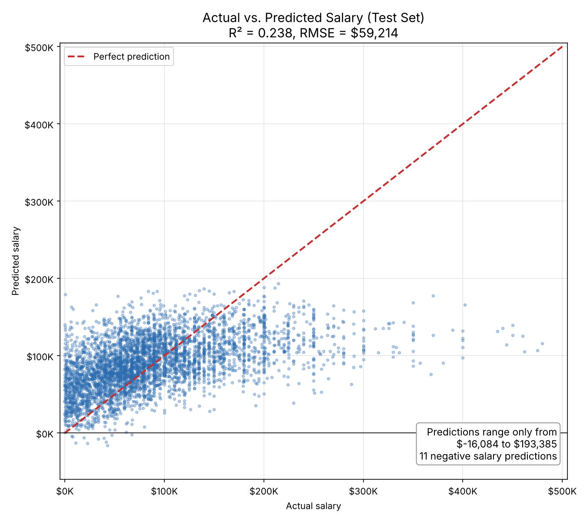
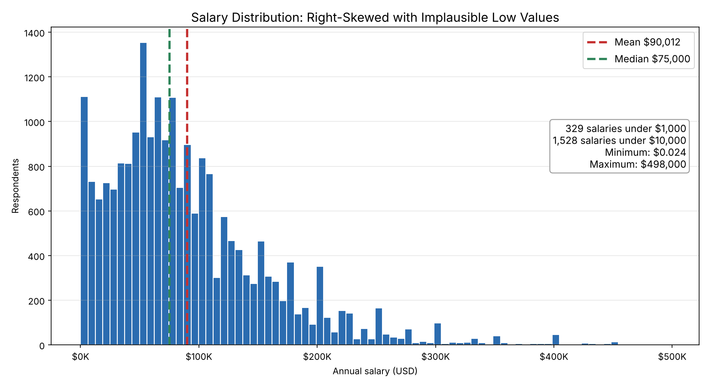
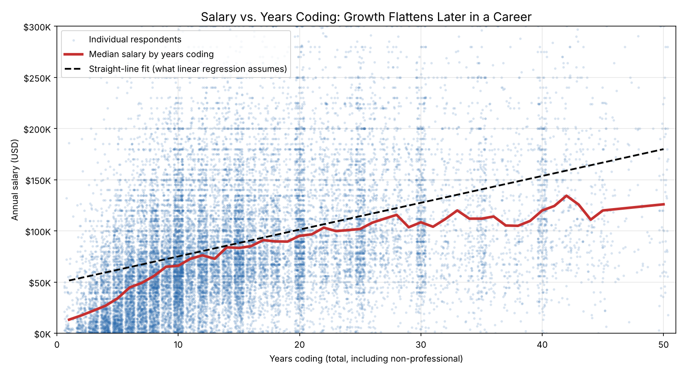
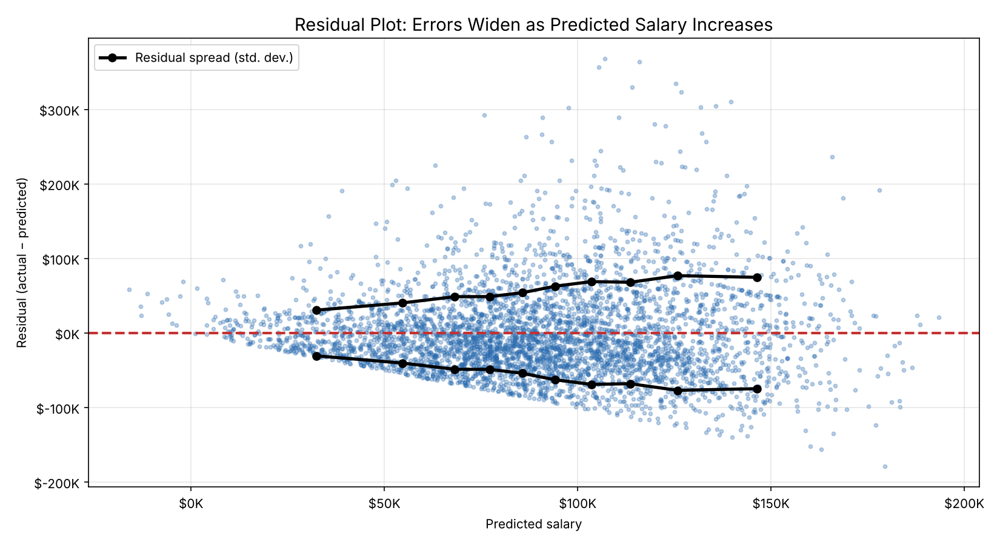

# Developer Salary Prediction with Multiple Linear Regression 💸

This repository contains a multiple linear regression model that predicts developer salaries from the 2024 Stack Overflow Developer Survey. Rather than presenting a polished result, this project is intentionally framed as a **teaching exhibit**: it shows what happens when speed takes priority over data quality, and why efficient workflows should never come at the expense of accuracy.

---

## Project Overview 📊

HR has asked for a model to guide salary offers for a new developer position. This project follows the CRISP-DM process (Business Understanding, Data Understanding, Data Preparation, Modeling, Evaluation, Deployment) using scikit-learn's `LinearRegression` on a pre-cleaned subset of the [2024 Stack Overflow Developer Survey](https://survey.stackoverflow.co/2024/).

The exercise deliberately takes a shortcut: data preparation was done in advance, leaving only one-hot encoding before modeling. The resulting model is fast to build, but its weak performance reveals how much of a model's quality is decided during data understanding and preparation.

**Dataset at a glance:** 
- 21,807 survey respondents, 6 predictors, no missing values
- Expands to 34 predictors after one-hot encoding (`pd.get_dummies`, `drop_first=True`)
- Source survey: 65,437 developers across 185 countries, fielded May 2024, with salaries converted to USD at June 11, 2024 exchange rates

| Feature | Type | Description |
|---------|------|-------------|
| Age | Categorical | Age range |
| RemoteWork | Categorical | Remote, hybrid, or in-person |
| EdLevel | Categorical | Highest education level |
| YearsCode | Numeric | Total years coding (including non-professional) |
| primaryDB | Categorical | Primary database used |
| primaryLang | Categorical | Primary programming language |
| Salary | Numeric (target) | Annual compensation in USD |

---

## Key Findings 🔎

### The Model Explains Less Than a Quarter of Salary Variation ⛔

| Dataset | R² | RMSE |
|---------|-----|------|
| Training set | 0.226 | $60,949 |
| Test set | 0.238 | $59,214 |

On average, salary predictions miss by about **$59,000**, against a median salary of $75,000. The salary standard deviation is $68,987, so the model improves only modestly on simply predicting the average salary for everyone.

### The Model Is Underfit, Not Overfit ≤

Training and test performance are nearly identical, and test R² is even slightly higher. The model generalizes consistently, but it is consistently weak: the problem is missing signal and noisy data, rather than memorization.

### The Data Quality Warning Signs Were Visible Early ⚠️

Basic descriptive statistics flagged problems before any modeling began:

- **Minimum salary of $0.024** - an implausible value pointing to entry, unit, or conversion errors
- **Mean ($90,012) well above median ($75,000)** - a right-skewed target that ordinary least squares handles poorly
- **Maximum of $498,000** - extreme high-end values that pull the regression line and inflate error

### Experience Is Measured Too Broadly 🔭

`YearsCode` counts all years of coding, including school and hobby projects, rather than professional experience. It also enters the model as a straight line, while salary growth typically flattens later in a career.

### The Most Important Predictor Is Missing 🧩🔎

Respondents come from 185 countries, and all salaries were converted to a single currency. Without **country or region** in the feature set, the model cannot distinguish a developer in San Francisco from one with identical skills in a lower-cost market, leaving a large share of salary variation unexplained.

---

## Models and Performance 📈

### Model Configuration

- **Algorithm**: `LinearRegression` (ordinary least squares)
- **Encoding**: one-hot encoding with `drop_first=True` to avoid perfect multicollinearity
- **Train/test split**: 80/20 (`random_state=42`)
- **Evaluation metrics**: R² and RMSE (MSE reported for reference)

### Full Results

| Metric | Training | Test |
|--------|----------|------|
| R² | 0.2259 | 0.2375 |
| MSE | 3,714,731,944 | 3,506,285,016 |
| RMSE | $60,949 | $59,214 |

MSE is reported in squared dollars, which is why the values are so large. RMSE converts the error back to dollars, making it the more interpretable metric for stakeholders.

### Residual Analysis 🔬

Residuals widen as predicted salary increases, a sign of heteroscedasticity. The model's errors are not random: it systematically underpredicts high earners, which a log-transformed target would help address.

---

## Lessons for Practitioners 💡

1. **Efficiency Should Not Replace Data Understanding**
   - Skipping the exploratory and preparation stages saved time but produced an unusable model
   - Warning signs (an impossible minimum salary, a skewed target) were visible in a single `describe()` call

2. **Feature Selection Must Reflect the Business Question**
   - A salary model without location ignores one of the strongest drivers of pay
   - Proxy variables like total years coding blur the effect of professional experience

3. **Fit Metrics Need Context**
   - Similar training and test scores confirm a stable model, not a good one
   - RMSE should be compared against a naive baseline (predicting the mean) to judge real improvement

4. **Know When a Model Is Not Ready for Deployment**
   - At ±$59K average error, this model should not guide real compensation decisions
   - Documenting why a model fails is as valuable as reporting one that succeeds

---

## Repository Contents 📁

1. **Data Files**
   - [Cleaned Stack Overflow Survey Data](cleanedSO.csv) (CSV)

2. **Notebooks**
   - [Salary Prediction with Multiple Linear Regression](salary-prediction-linear-regression.ipynb) (IPYNB)

3. **Visualizations**
   - [Actual vs Predicted](actual-vs-predicted.png) (PNG)
   - [Salary Distribution](salary-distribution.png) (PNG)
   - [Salary vs Years Coding](salary-vs-years-coding.png) (PNG)
   - [Residual Plot](residual-plot.png) (PNG)

---

## Model Evolution 🧠

This project follows the CRISP-DM lifecycle, with the shortcuts made explicit:

1. **Business Understanding**: Define the goal of recommending salaries for a new developer role.

2. **Data Understanding and Preparation**: Use a pre-cleaned survey extract and apply one-hot encoding. *This is the stage where the shortcut was taken.*

3. **Modeling and Evaluation**: Train a multiple linear regression model and evaluate it with R² and RMSE, revealing an underfit model with large errors.

4. **Diagnosis**: Trace the poor performance back to data quality issues, a skewed target, coarse features, and a missing location variable.

The value of this exercise lies in step 4: connecting weak results back to decisions made earlier in the process.

---

## Future Work 🚀

Potential extensions to turn this into a deployable model include:

- Filtering implausible salaries and treating extreme outliers
- Log-transforming the salary target to address skew and heteroscedasticity
- Adding country or region, plus employment type (full-time vs. part-time), from the full survey
- Replacing `YearsCode` with professional experience (`YearsCodePro`) and testing non-linear experience effects
- Comparing regularized and tree-based models (Ridge, Lasso, random forest, gradient boosting)
- Benchmarking every model against a naive mean-salary baseline

---

## Contact Information ✉️

For inquiries about this analysis:

- [LinkedIn Profile](https://www.linkedin.com/in/melissaslawsky/)
- [Client Results](https://melissaslawsky.com/portfolio/)
- [Tableau Portfolio](https://public.tableau.com/app/profile/melissa.slawsky1925/vizzes)
- [Email](mailto:melissa@melissaslawsky.com)

---

## Disclaimer 📝

This project was completed as part of the [Udacity Data Science Nanodegree](https://www.udacity.com/course/data-scientist-nanodegree--nd025) program. The data is a pre-cleaned extract of the [2024 Stack Overflow Developer Survey](https://survey.stackoverflow.co/2024/), and the exercise structure was provided by Udacity. 

---

© Melissa Slawsky 2026. All Rights Reserved.
